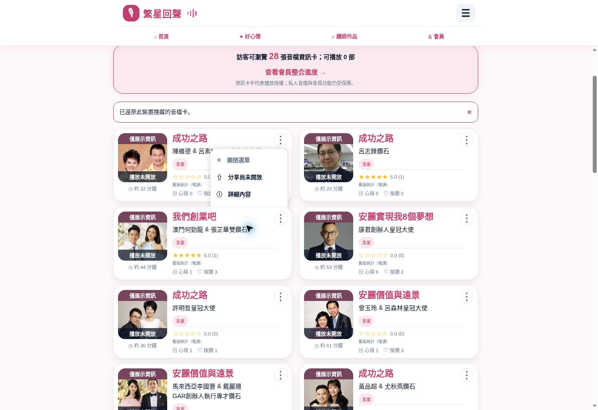

# Work 正式 UI 驗收與選單回歸

日期：2026-10-29（台灣）。正式網站：https://echo-starry.starry-phd.workers.dev/ 。最新部署／回歸狀態以Issue #3頂端為準。

## 已驗收的PR19正式版

Release `ed1262b2c1e0097a7a531aee6491d68008cc7a3c`，Production #40848841175 success；Cloudflare deployment `59d2dd9a-f3a7-4705-ad4b-e01dcfba159b`，version `dc61b95e-1f8b-4876-b041-0a26b3f4b7c9` 100%。

| 項目 | 實測證據 |
| --- | --- |
| 28張照片 | 正式HTTP smoke逐張成功，瀏覽器28/28已解碼；28卡playable=false、私人stream=404 |
| 手機 | 實際CSS390×844，scrollWidth=clientWidth=390；桌面亦可見雙欄，但精確1440×900未另做覆蓋 |
| 新人框 | 8個標籤；transform由-74.27px變為-33.215px，確認持續循環；重新載入無先前native-driver/hydration錯誤 |
| 篩選 | 講師獎銜鑽石=9張；成功＋鑽石AND=13張；搜尋無結果時分類仍有事業／新人／激勵 |
| 收藏 | 卡片加入→收藏頁可見→詳情取消→收藏頁空→首頁回到加入收藏，跨頁同步；只屬本裝置 |
| 純資訊詳情 | 照片、姓名、獎銜、時長、舊上架日、歷史統計可見，audio/video元素0，不開放播放／分享 |
| 跨頁隱藏 | Cloud Browser逐步確認講師頁隱藏後無作品，首頁27張；原先一段未等導頁完成的讀回不作通過證據 |

## 真正發現的選單遮擋

桌面第一張卡的選單延伸到下一排時，加入收藏／我不喜歡被下排卡片蓋住；UI可存取樹仍有按鈕，卻不能正常點選。初看像跨頁偏好失效，逐步操作與截圖才確認是堆疊遮擋。

修復採React Native `Modal`，將選單放在卡片清單之外，以原生ref量測按鈕位置，依viewport選擇上方／下方並限制四邊；背景點擊、關閉鈕與Android返回可關閉。每列最小44px，卡片觸控區加hitSlop。`cardMenuLayout`測試覆蓋280–1440px及視窗上下邊緣。

修復後需在正式部署重新驗收：五個選項可完整看見且可點、首頁我不喜歡28→27、重載仍27、還原28、跨頁同步、收藏操作、背景關閉、純資訊詳情、28照片及音訊404。程式與layout測試通過不代替這一輪實測。

## 尚未覆蓋

原生iOS/Android簽章build、真機、OS背景播放、完整原版評論／AI／VIP／貼紙、逐筆錄音播放權利仍未完成；不宣稱100%移植或商店上線。Ads OFF，所有112原始音訊維持private/copied。
