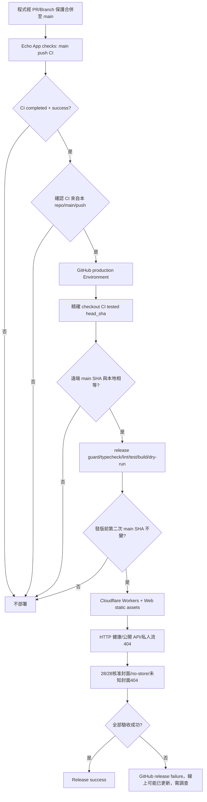

# 2026-10-30｜繁星回聲：自動化「公開 Web shell」Production 發布

## 業主要求與適用範圍

業主明確要求把每次 GitHub Production 手動審批改為**CI 綠燈後全自動部署**，減少不必要的手機手動 Run workflow 和 Approve and deploy。此變更**只適用 Echo 的公開 Web shell 與已核准唯讀 API**。私人音訊 112 筆（過往唯讀 snapshot）、私人 R2 抽查／稽核、中央 Starry ID、付費/電池、EAS 上架等**均不因這個功能自動授權**。

## 新受信任事件鏈

- 原版 `.github/workflows/ci.yml` 仍只在 main push / PR 執行 CI。**不能因 PR CI 綠燈就觸發 production**：新的 `workflow_run` job 同時檢查 `conclusion=success`、`event=push`、`head_branch=main`、`head_repository.full_name=github.repository`，以及用 `workflow_run.head_sha` 精確 checkout。
- 發布**仍在 `environment: production`**，仍有 `concurrency: echo-starry-production` 且不取消正在部署的任務。保留重跑所有 release safety checks、兩次現場核對 main SHA，任何時候 main 移動就停止，並確保 `starry.app.json.lifecycle.productionAuthorized=true`。
- 仍保留 `workflow_dispatch` 作為緊急**人工啟動**備援，需相同 `DEPLOY-ECHO-STARRY-PRODUCTION`、40位 SHA、main 等同驗證；但日常無須使用。
- **私人 R2 probe/audit 工作流一律只能手動**，所有 API media gate、28封面白名單、HTTP smoke 都照舊，Ads OFF。
- 新 `scripts/check-release-safety.mjs` 與 `tests/release-safety.test.mjs` 會拒絕直接 push trigger、PR/不成功/外部 repo CI、移除 production environment、移除 SHA pin、撤銷私人音訊安全 smoke，還會驗證 private audit/probe 只能手動。

## 業主一次性 GitHub 設定（程式無權修改 Environment）

**這是必要的最後一步，不是 ChatGPT 可以從一般 GitHub connector 完成的操作。**

1. 開啟 https://github.com/starry-phd/echo/settings/environments
2. 點現有的 **production**（不要新建或刪除）。
3. 在 **Deployment protection rules** 下，將 **Required reviewers** 的勾選取消，然後按 **Save protection rules**。
4. 在 **Deployment branches and tags** 限制為 **Selected branches and tags: main** 或 GitHub **Protected branches only**（前提是真正的 main 保護規則已配置）。不要設定成 **All branches**。
5. 不要刪除 Production Environment、不移除 secrets、不修改 private R2 migration environment 或 main branch protection。
6. 檢查 Actions：第一筆 **來自 main push CI success 產生的** `Deploy Echo public Web shell to Cloudflare Workers` 自動 run，應不需人審核即可執行並完成所有安全驗收。若在這個 PR 合併後因仍有 Required reviewers 而顯示 Waiting，**切勿重複按 Run workflow**；設定變更後檢查該筆 run 狀態，若仍等待依官方 UI/規則操作；不可未查明而重複部署。

**重要差異**：取消 Required reviewers 是在移除人工阻擋，不是讓機器假冒人的審核。這會讓任何合法合併至 main 且完成安全 CI 的**公開站版本自動進入正式環境**；相對於原有人工審查，風險確實提升。尤其未來新增私人音訊/會員/收費流程之前，必須先新建專門授權檢查、重新審視自動發布政策，必要時恢復 human gate。

## 注意

GitHub Actions **success ≠ 未經使用者實機驗收的全站 UI 完全 1:1**。部署後必須維持安全 HTTP smoke 和必要的瀏覽器/行動裝置實測，Issue #3 繼續記錄來源及失敗診斷。
