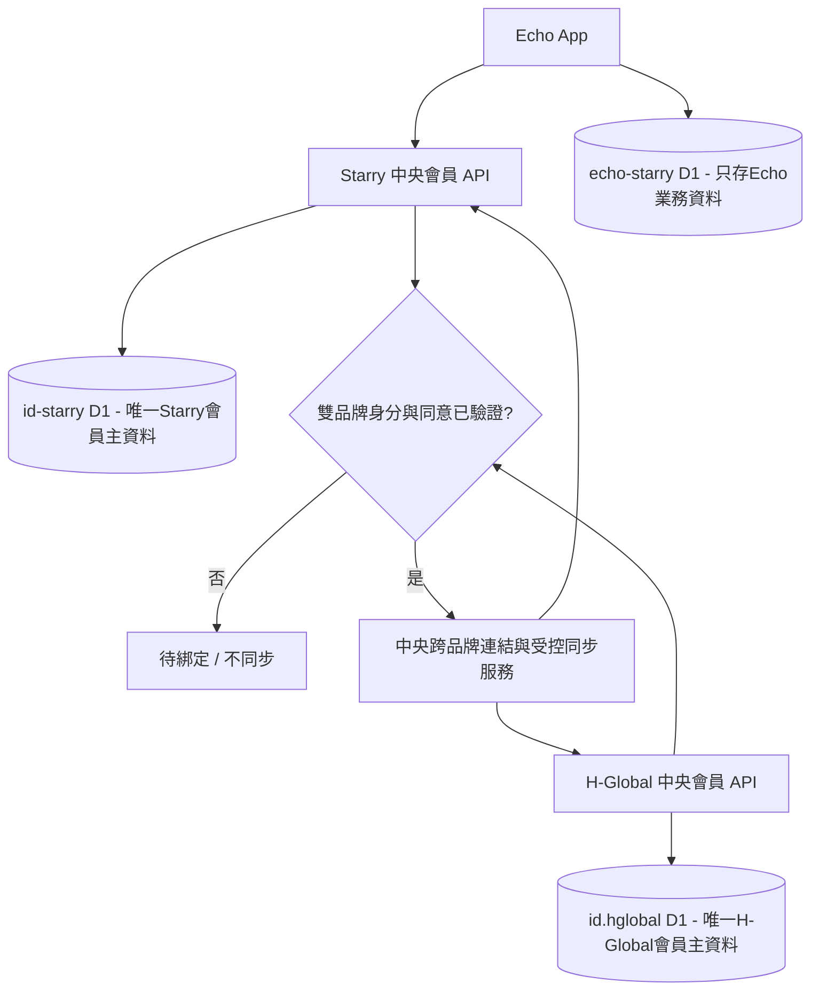

# ADR-0003｜Echo 會員唯一資料權威及跨生態系安全綁定（規格接線階段）

- 狀態：**APPROVED DIRECTION / CONTRACT PENDING / NOT DEPLOYED**。
- 提出日期：2026-10-30（台灣）。
- 適用版本：**《最新開發技術規範》整合版 v1.0**（2026-10-29 + 2026-10-30 業主六項決議、S2 補充）、開發流程 v3.0；涉及 UP-01、UP-02、UP-03、UP-04、UP-10、UP-11、UP-13、UP-15、UP-16、UP-17、UP-19、UP-21、UP-24。
- 線上唯一規範來源：[Google Doc 最新開發技術規範](https://docs.google.com/document/d/1urLja9i9A63jHuz4jQPhPMTgoCtoq-i1TafXPQd3PYU/edit?usp=drivesdk)，此次已以實際文件內容查核，後續以該文件當時版本與 GitHub 對應 SHA 為準。
- 原版參考：`yukidu/Echo-Starry`；新版程式：`starry-phd/echo`；唯一 Echo 業務資料庫：Starry Cloudflare 帳戶的既有 `echo-starry` D1；媒體 R2 同名。
- 中央 ID 工程權威：`starry-phd/id`，由另一工作流負責；**未取得正式上線的 Auth/Me/跨品牌 OpenAPI、Session/撤權與 signed proof 驗收前不可假稱可用**。

## 1. 資料權威與禁止事項

| 資料／操作 | 唯一可寫權威 | Echo 的權限 |
| --- | --- | --- |
| Starry 會員本人資料／隱私旗標 | Starry 中央會員 API，背後預定 `id-starry` D1 | 經可信授權後**只讀**中央 API 的本人 DTO；不可把會員 email/手機/姓名寫入 `echo-starry` 當會員主檔 |
| Echo 分類、音檔、可見性、留言、收藏、播放進度 | Echo Worker + `echo-starry` D1 | 按中央使用者不透明 `s_user_id` 參照，驗證 Echo app scope／env／權限 |
| Echo 原版 `users`、`auth_sessions`、憑證及 VIP 秘鑰 | 不可提升為中央權威 | 不匯入可用 session／密碼／OTP／舊會員主資料；`legacy_*` 僅隔離待核 |
| H-Global 基本個資 | H-Global 中央會員 API，背後原系統 `id.hglobal` | Echo **不讀也不寫** H-Global D1，不做跨帳號直接合併 |
| Starry ↔ H-Global 關聯及本人基本資料同步 | **雙方中央會員後端**經互信契約／身分/同意/稽核決策 | Echo 不持對端 credential，不控制雙品牌同步與直接 D1 交易 |

中央個人資料 DTO 以整合版規範 §6.1 已指定的 **`GET /v1/starry-id/members/me` 五欄**為準：
`s_user_id`、`display_name`、`directory_opt_in`、`display_name_public`、`profile_revision`。
原 `docs/02-central-member-api-contract.md` 曾猜測 `GET /v1/me` 與 `userId/displayName/avatarUrl/version`，屬過期候選，**不可佯稱與正式中央契約相同**；本 ADR 隨 PR 更正 Echo 的型別及離線測試。
API 地址、OAuth 發行者／audience、scope、token 驗證、Session 撤銷、前後端完整流程仍依中央 `starry-phd/id` 的真實部署結果與版本化規格才能接入。
中央目前只公布 health-only DRAFT 的 `apps/api/openapi.yaml`，沒有 `GET /v1/starry-id/members/me` 的正式可用授權服務。

## 2. 2026-10-30 最新業主的新需求：雙品牌基本資料在後續註冊／登入／修改時「自動」綁定同步

**產品意圖**：某人已擁有 Starry 帳號，日後註冊／登入或更新 H-Global 帳號時，符合安全與隱私條件的兩個中央服務自動串接，必要範圍的「基本」個人資料保持一致；反向流程亦應討論。

**需受審變更的衝突**：現行整合規範 UP-02 仍明示「不按 Email／姓名合併跨品牌帳戶、不共用正式 D1、不介入 H-Global」。最新業主要求應視為跨品牌互通的新**產品方向**，但**不是取消反錯綁、個資最小化與服務隔離的安全要求**。因此設計為「完成雙方身分和同意驗證後，後端在事件觸發時自動啟動」；不是「相同 Email 即自動認定同一人」。此重大變更應在 Starry ID 與 H-Global 中央權威 Repo 各自記錄/受審 ADR，與業主確認同步欄位、衝突優先及同意方式後才能上線。

建議受控流程：

1. **觸發**：雙方中央 API 收到該品牌的 `account.registered`、`session.login.succeeded`、`basic-profile.updated` 類事件（此處只是概念事件名稱，非正式路由）。
2. **候選匹配**：不得直接使用同 Email/姓名/電話等未驗證資訊建立關聯。必須先在兩個不同品牌完成可信登入，驗證各自 issuer/audience／Session 未撤銷，並經雙方所有權證明；Email 最多作未授權不洩露存在性的候選提示。
3. **同意與安全**：提供用途、同步的精確白名單欄位、衝突規則、撤回／刪除後效果的通知；以經確認的雙方用戶同意或適用合法基礎為 Gate。任何一方不能證明同一人的情況一律 `PENDING / NO LINK`，不可自動同步。
4. **持久配對**：由專責中央服務保存最小不透明 Starry ID↔H-Global ID 映射與版本、同意記錄及稽核；每次更新帶 event ID 與來源版本和 idempotency Key，拒絕過期/重播/非授權來源，支持延遲、重試、DLQ／對帳及斷鏈。
5. **欄位與迴圈**：只同步業主之後核准的基本資料白名單，依欄位主責或有明確衝突的版本 CAS；附上 sourceBrand／originEventId，抑制 Echo↔Hglobal 回送循環。不得跨品牌傳付費權益、Battery、VIP／貼紙、社群活動、隱私 scope。
6. **刪除與復原**：任一品牌的合法刪帳／撤回須同步下游撤權／清除應刪資料，遵從已核准的法定最小保留及防 PITR 復活方案；不能以保留 email 永久追蹤/防重領。
7. **Echo 故障隔離**：中央服務未完成時，Echo 的匿名首頁／28 張核准公開資訊卡仍可正常運作；登入、會員收藏、買斷、雙品牌「已同步」狀態一律 fail closed，**不得顯示假成功**。

**明確非本 PR**：不呼叫 Hglobal 服務、不修改 `id-starry` 或 `id.hglobal` 資料庫、不建立 OAuth 客戶端/新 D1/Queue、不假造中央可用 API、不解鎖私人媒體、不啟用 RevenueCat/AdMob、不部署正式版。

## 3. 舊資料與發佈實況的維持

- 依 Issue #3 已驗資料：R2 舊來源有效 **596 個／3,122,987,926 Bytes** 已複製至新帳戶，尚待私人音訊權利與解碼稽核。**檔案搬完不等於已准公開播放**。
- Echo D1 正式 `echo_tracks` **112/112 `private/copied`**，28 張合法資訊卡封面可顯示不可播放；`echo_guest_previews` 28、`echo_guest_card_media` 28。
- 舊 `echoes_db` 50 應用資料表、2,534 列；在**同一個 `echo-starry` D1** 已有 10 張隔離 `legacy_*` 表、182 列的上次快照。當中 `legacy_ai_story_facts` 70/264、`legacy_tracks` 28/112，不能說移植完成；前次跨帳戶搬移遇平台安全限制，不嘗試繞過。
- 已發布的 Web Worker 與最新 GitHub main 差異是否含 Runtime，依 Issue #3 與即時 Actions/Cloudflare 查證；本 PR 只涉及規格、離線五欄 DTO、測試與不連線的 fail-closed adapter，**不需要也不應藉此重複正式部署**。
- 驗收：Node tests 驗證五欄／拒絕舊 schema／額外 PII／錯 ID/修訂號；`getCentralMemberProfile()` 在未部署時保持 reject。每次需要真登入/綁定，另按正式 Gate 取得兩服務的已部署 OpenAPI、安全及測試者身分證據。

## 4. 待中央 Owner 提供的正式依賴清單

- Starry ID：中央已簽發/撤權 Session 契約、`GET /v1/starry-id/members/me` 真實部署與 SDK、必要 scope／DTO、隱私與 401/403、憑證安全。
- H-Global：既有 `id.hglobal` 真 API、相互可信的身份／雙方 proof、可受審的跨品牌授權和撤回流程。
- 雙品牌同步：資料欄位白名單（不含特殊類別）、配對/取消/刪除、來源／衝突、事件簽章/idempotency/freshness、防迴圈及延遲補償、實際兩端 Test 身分與測試資料。
- 測試與成本：依文件 S2 先做既有資源/OAuth 唯讀盤點與能力包，額外測試資源、OAuth 帳戶修改、新付費/正式 Release 需個別核准；不可用 Echo Production 作未授權 Staging。

